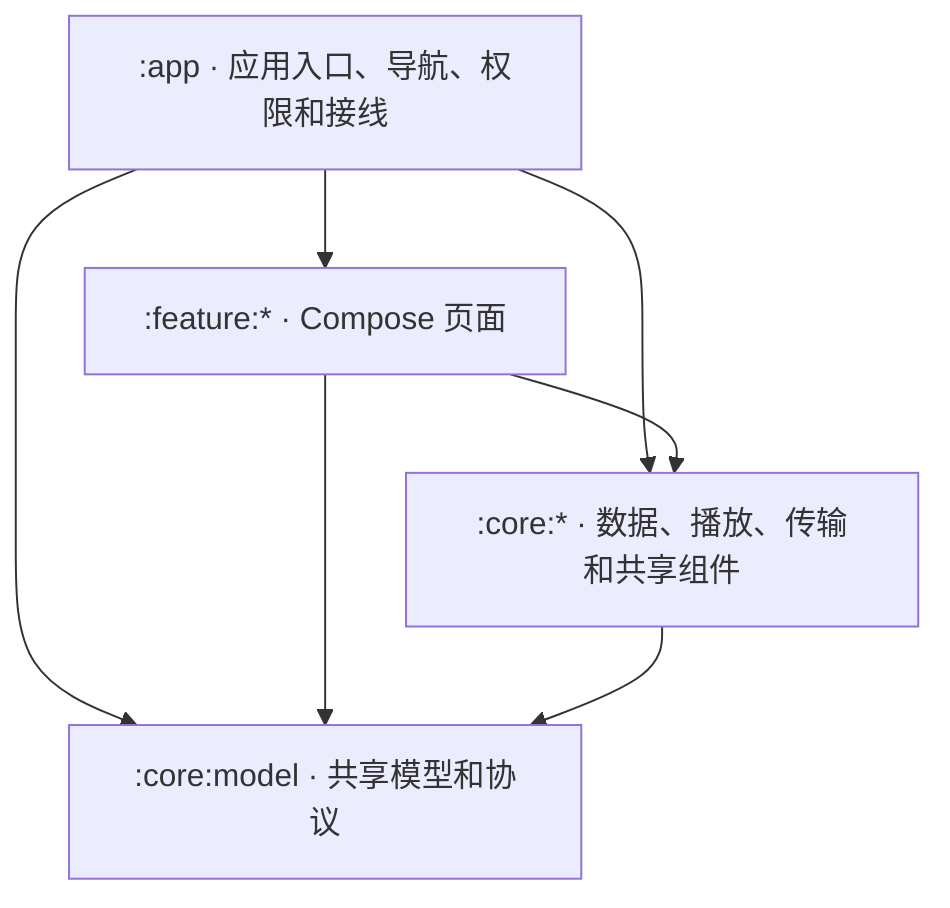

# ECHOAndroid 项目地图与 CI

## 从哪里开始改

图中箭头表示模块层之间的依赖方向。各 core 模块之间的依赖见生成的清单。

| 要改的能力 | 代码入口 | 相关 core |
| --- | --- | --- |
| 应用入口、权限、导航 | [MainActivity](../app/src/main/java/app/echo/android/MainActivity.kt)、[EchoAppRoot](../app/src/main/java/app/echo/android/EchoAppRoot.kt) | [主题与组件](../core/design/)、[语言](../core/i18n/) |
| 首页、曲库、听歌记录 | [home](../feature/home/)、[library](../feature/library/)、[listening](../feature/listening/) | [Room、扫描、设置和远程来源](../core/data/)、[听歌服务](../core/listening/)、[SMB](../core/smb/) |
| 播放器、歌词、音效和 USB | [player](../feature/player/)、[settings](../feature/settings/)、[PlaybackController](../app/src/main/java/app/echo/android/PlaybackController.kt) | [Media3、DSP 和通知](../core/playback/)、[USB 独占](../core/usb-audio/)、[歌词解析](../core/lyrics/) |
| Echo Link | [connect UI](../feature/connect/) | [发现、配对和传输](../core/connect/)、[协议模型](../core/model/src/main/java/app/echo/android/model/connect/) |
| 插件、电台、播客 | [plugins](../feature/plugins/)、[radio](../feature/radio/)、[podcasts](../feature/podcasts/) | [插件运行时](../core/plugin/)、[电台与播客数据](../core/data/) |

模块由 [settings.gradle.kts](../settings.gradle.kts) 注册。新增 `project()` 依赖时同步维护[依赖白名单](../gradle/allowed-module-graph.txt)，遵循 [AGENTS.md](../AGENTS.md) 的边界。运行 `./gradlew checkModules --no-configuration-cache`（Windows 用 `.\gradlew.bat`）会校验并生成 `build/reports/module-map.md`，其中列出当前源码声明的直接依赖。

Echo Link 的 PC 服务端和桌面端 UI 位于独立的 [ECHOSteam 仓库](https://github.com/moekotori/echosteam)。

## 从提交到 APK

[CI 工作流](../.github/workflows/ci.yml)在 PR、推送 `main` 或手动运行时触发。同一引用的新运行会取消旧运行。GitHub 托管的 Linux runner 使用 JDK 21、Android SDK 37、NDK 27.2 和 CMake 3.22.1，并复用 Gradle 与 FFmpeg 缓存。

| 作业 | 执行内容 | 可下载产物 |
| --- | --- | --- |
| `Check workflows and release tooling` | 校验 Actions YAML 和表达式，运行发布脚本单测 | 在作业日志查看结果 |
| `Test and assemble` | `checkModules checkLocalization`，然后 `testDebugUnitTest assembleDebug`。检查 Debug APK 签名，以及 ARM64、ARMv7、x86-64 三种 ABI 各自的 DSP、USB 和 FFmpeg JNI 库 | `module-map`、`test-reports`、`echoandroid-debug-<运行编号>`，保留 14 天 |

在 [Actions](https://github.com/Moekotori/echoandroid/actions/workflows/ci.yml) 打开对应运行。模块图和本地化检查通过后即可下载模块图，测试报告在有报告文件时上传，Debug APK 在全部检查通过后上传。

默认 CI 使用 Debug 签名。`lintDebug` 用于按模块排查，真机、仪器和 USB 验收单独进行。正式签名和草稿发布走手动触发的 [Release 工作流](../.github/workflows/release.yml)。本地正式打包和更新元数据见 [Android 更新说明](./android-updates.md)。
